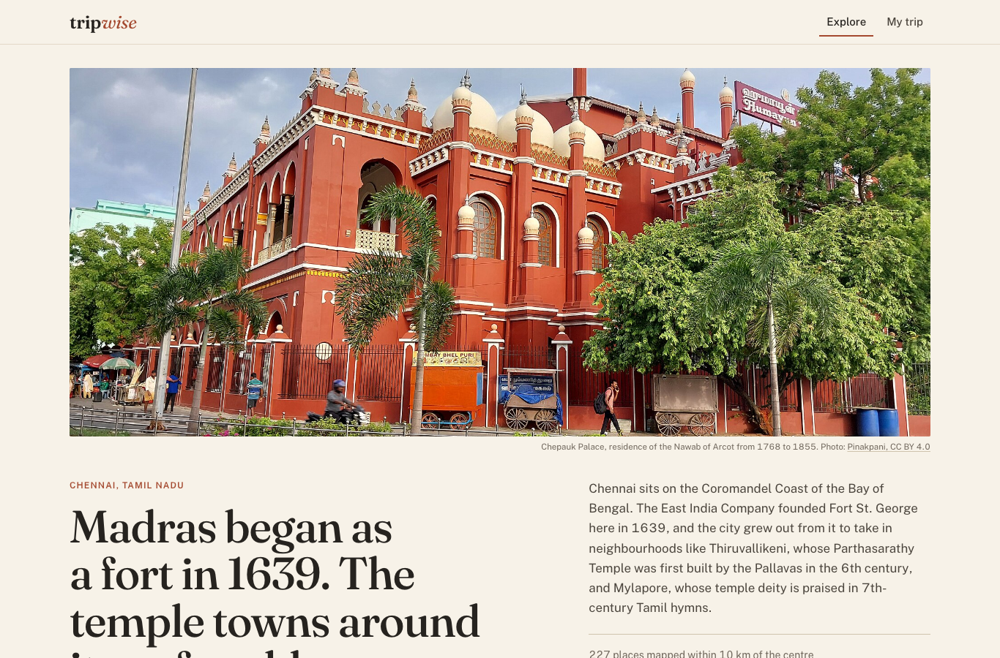
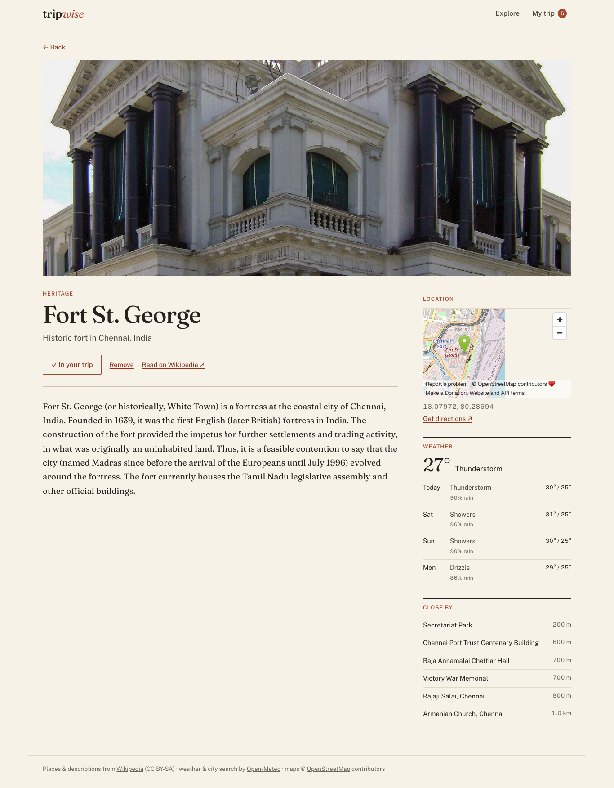
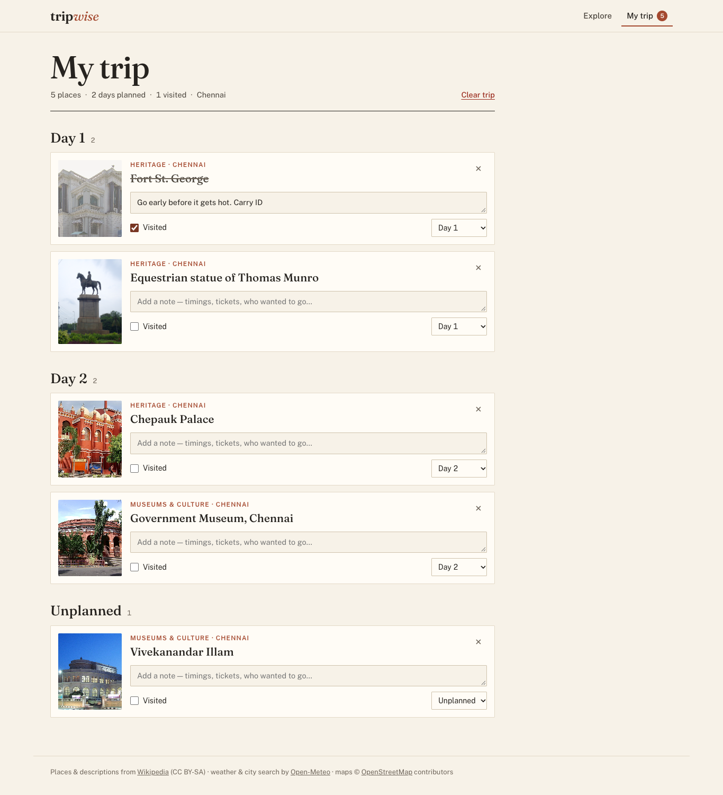

# TripWise

A travel planner where you pick a city, browse places worth seeing around it, open one up for details, and save the ones you like into a trip that you can split into days.

**Track:** Full-Stack (React frontend + Express API + MongoDB)

**Live demo:** https://tripwise-9dqg.onrender.com

| Explore | Place details | My trip |
| --- | --- | --- |
|  |  |  |

## What it does

- **Explore any city.** Each city opens with a photo and a short introduction. Chennai has a hand-written guide; for every other city the intro and lead photo come from that city's Wikipedia article. Search for another city with autocomplete.
- **Places to start with.** A short curated set shown before the full list. For Chennai it's six places I chose, with notes written from their Wikipedia articles and a credited Wikimedia Commons photo that actually shows each place. For other cities it's the top-ranked places that have photos.
- **Every place nearby.** All geotagged places around the centre as cards, each with its photo, category, distance and the first sentence or two of its Wikipedia article.
- **Search, filter, sort.** Type to search within the results, filter by category (heritage, museums, places of worship, parks, landmarks, neighbourhoods), limit the radius to 2, 5 or 10 km, hide places with no photo, and sort by top picks, distance or name. All filters live in the URL, so back/forward and shared links keep them.
- **Place details.** The Wikipedia summary, a map, a link for directions, a 4-day weather forecast for that spot, and other places close by.
- **My trip.** Add or remove places, assign each one to a day (or leave it unplanned), write a note, and tick it off when visited. The trip is stored in MongoDB.
- **Loading, empty and error states** everywhere: skeleton cards while loading, specific empty messages (no results vs. no places in this area), retry buttons when a request fails, and a toast when a save doesn't go through.

There are no accounts. The first time you open the app, the browser generates a random trip id and keeps it in `localStorage`. Itinerary items are stored in MongoDB under that id, so your trip is still there after a refresh or a server restart.

## Tech used

| Part | Stack |
| --- | --- |
| Frontend | React 18, React Router 6, Vite, plain CSS (Fraunces + Public Sans) |
| Backend | Node.js (18+), Express 4 |
| Database | MongoDB with Mongoose |
| Hosting | Render (one web service serves both the API and the built frontend) + MongoDB Atlas |

## External APIs

None of these need an API key, so there are no secrets in the frontend or the repo.

| API | Used for |
| --- | --- |
| [Wikipedia Action API](https://www.mediawiki.org/wiki/API:Geosearch) (`generator=geosearch`) | Places near a coordinate, with descriptions and thumbnails |
| Wikipedia Action API (`prop=extracts`) | Summary text and a larger photo for the details page |
| [Open-Meteo Geocoding](https://open-meteo.com/en/docs/geocoding-api) | City search / autocomplete |
| [Open-Meteo Forecast](https://open-meteo.com/en/docs) | Current weather and a 4-day forecast on the details page |
| OpenStreetMap embed | The small map on the details page |

I started with OpenTripMap/Overpass, but the public Overpass servers kept timing out while I was testing, so I switched to Wikipedia's geosearch. It's run by Wikimedia, it's fast, and almost every result has a photo and a one-line description.

A few things I had to work around:

- **Geosearch only returns the 100 articles nearest to a point.** In a dense city that's barely 2 km. For the 5 and 10 km radius the server also searches from 6 points in a ring around the centre and merges the results, so Chennai goes from about 50 places to over 200.
- **Wikipedia has no "category" field.** Each article does have a short description like "Hindu temple in Tamil Nadu, India". [`categorize.js`](server/src/lib/categorize.js) maps those descriptions to categories with keyword rules and drops things that aren't places to visit (railway stations, schools, constituencies, events…).
- **Lead images aren't always photos.** Locator maps, logos and SVG diagrams are dropped, so the card falls back to a plain placeholder instead.
- **Responses are cached** in memory for an hour, so changing filters doesn't hit Wikipedia again. Requests to each host are limited to 3 at a time and retried with backoff on 429/503, because Wikipedia rate-limits clients that send bursts.

### The Chennai guide

[`client/src/data/guides.js`](client/src/data/guides.js) holds the Chennai hero and the six starter picks. Every fact in it comes from the intro of the linked Wikipedia article (checked October 2026), and every photo was checked by eye to make sure it shows the named place. Photo credits and licences are shown under each image. The place data itself (coordinates, category, summary) still comes from the API, so "Add to trip" works the same as everywhere else. Adding another city means adding another entry to that file.

## How it fits together

```
React (Vite)  ──/api──▶  Express  ──▶  Wikipedia / Open-Meteo
                            │
                            └──▶  MongoDB (itinerary items)
```

The frontend only ever talks to my API. The API does the external calls, filtering, sorting and pagination, and owns the database.

```
tripwise/
├── client/                 React app
│   └── src/
│       ├── pages/          Explore, Place, MyTrip
│       ├── components/     CityHero, StarterPicks, PlaceCard, TripButton, CitySearch, ...
│       ├── data/           hand-written city guides (Chennai)
│       └── lib/            api client, trip context, category labels
└── server/
    └── src/
        ├── routes/         destinations.js, itinerary.js
        ├── services/       wikipedia.js, weather.js, geocode.js
        ├── models/         ItineraryItem.js
        └── lib/            categorize, geo maths, cache, errors
```

## Running it locally

You need Node 18.17 or newer.

```bash
git clone <this repo>
cd tripwise
npm run setup              # installs server and client dependencies
cp server/.env.example server/.env
```

Then in two terminals:

```bash
npm run dev:server         # API on http://localhost:4000
npm run dev:client         # app on http://localhost:5173
```

Vite proxies `/api` to port 4000, so just open http://localhost:5173.

### Database configuration

Set `MONGODB_URI` in `server/.env`. A free MongoDB Atlas cluster works:

```
MONGODB_URI=mongodb+srv://<user>:<password>@<cluster>.mongodb.net/tripwise
```

**If you leave `MONGODB_URI` empty in development**, the server starts a local MongoDB through `mongodb-memory-server` and keeps its files in `server/.data/`, so you can try the app without installing anything. The first start downloads the MongoDB binary, which takes a minute. In production (`NODE_ENV=production`) the server won't start without `MONGODB_URI`.

| Variable | Required | What it's for |
| --- | --- | --- |
| `MONGODB_URI` | in production | MongoDB connection string |
| `PORT` | no (default 4000) | Port for the API |
| `WIKI_CONTACT` | recommended | Contact put in the User-Agent, which Wikipedia asks API clients for |

The collection is `itineraryitems`. There's a unique index on `{ tripId, placeId }` so the same place can't be added to one trip twice.

## Deploying (Render + Atlas)

1. Create a free Atlas cluster and a database user. Under Network Access, allow `0.0.0.0/0` (Render doesn't have fixed IPs on the free plan).
2. On Render, create a new **Blueprint** from this repo (it picks up `render.yaml`), or a Web Service with:
   - Build command: `npm run build`
   - Start command: `npm start`
   - Env vars: `NODE_ENV=production`, `MONGODB_URI=...`, `WIKI_CONTACT=you@example.com`
3. When it's live, `/api/health` should return `{"ok":true,"db":"connected"}`.

Free Render services go to sleep after 15 minutes without traffic, so the first request after that takes around 30 seconds.

## API reference

Base URL: `/api`. Every error comes back in the same shape:

```json
{ "error": { "message": "sort must be one of: top, distance, name, -name.", "code": "BAD_REQUEST" } }
```

| Status | When |
| --- | --- |
| 400 | invalid query/body, bad ids, malformed JSON |
| 404 | place or itinerary item doesn't exist, unknown route |
| 409 | place is already in the trip |
| 502 | Wikipedia / Open-Meteo failed or timed out |
| 500 | anything unexpected |

### `GET /api/cities?q=jaipur`

```json
{
  "results": [
    { "id": 1269515, "name": "Jaipur", "region": "Rajasthan", "country": "India",
      "lat": 26.91962, "lon": 75.78781, "population": 2711758 }
  ]
}
```

### `GET /api/destinations`

| Param | Default | Notes |
| --- | --- | --- |
| `lat`, `lon` | required | centre point |
| `radius` | `10` | `2`, `5` or `10` (km) |
| `q` | | text search in name + description |
| `category` | all | comma separated: `heritage,museum,worship,nature,landmark,neighbourhood,other` |
| `photos` | | `1` to only return places with a photo |
| `sort` | `top` | `top`, `distance`, `name`, `-name`. `top` favours places with a photo, a description and a sight-like category, and ranks hotels lower |
| `page`, `limit` | `1`, `24` | limit max 100 |

`GET /api/destinations?lat=13.0878&lon=80.2785&category=heritage&sort=name&limit=2`

```json
{
  "center": { "lat": 13.0878, "lon": 80.2785 },
  "radius": 10,
  "total": 227,
  "count": 9,
  "page": 1,
  "hasMore": true,
  "categories": [
    { "key": "heritage", "label": "Heritage", "count": 9 },
    { "key": "museum", "label": "Museums & culture", "count": 8 }
  ],
  "results": [
    {
      "id": "627149",
      "name": "Fort St. George",
      "description": "Historic fort in Chennai, India",
      "category": "heritage",
      "lat": 13.07972,
      "lon": 80.28694,
      "image": "https://upload.wikimedia.org/...jpg",
      "distanceKm": 1.3
    }
  ]
}
```

`total` is everything found in the radius, `count` is what matches the filters. Category counts are worked out after the search and photo filters, so the chips show how many you'd get by clicking them.

Each result also has a `summary`: the first one or two sentences of the Wikipedia article, with bracketed asides removed. It's `null` if Wikipedia didn't return one.

### `GET /api/places?ids=627149,658270&lat=13.0878&lon=80.2785`

Looks up specific places by Wikipedia page id (max 20), in the order given. `lat`/`lon` are optional; with them, each result includes `distanceKm`. Used for the curated picks.

```json
{
  "results": [
    {
      "id": "627149",
      "name": "Fort St. George",
      "description": "Historic fort in Chennai, India",
      "category": "heritage",
      "lat": 13.07972,
      "lon": 80.28694,
      "image": "https://upload.wikimedia.org/...jpg",
      "summary": "Fort St. George is a fortress at the coastal city of Chennai, India.",
      "distanceKm": 1.3
    }
  ]
}
```

### `GET /api/cities/overview?name=Jaipur&lat=26.91962&lon=75.78781`

Intro and lead photo for a city, from its Wikipedia article. The article's coordinates must be within 40 km of `lat`/`lon`, otherwise the response is `404`, so Paris, Texas doesn't get the French article.

```json
{
  "title": "Jaipur",
  "description": "Capital of Rajasthan, India",
  "intro": "Jaipur is the capital and the largest city of the north-western Indian state of Rajasthan. ...",
  "image": "https://upload.wikimedia.org/...Hawa_Mahal...jpg",
  "wikiUrl": "https://en.wikipedia.org/wiki/Jaipur"
}
```

### `GET /api/destinations/:id`

`id` is the Wikipedia page id. Weather and nearby places are fetched in parallel. If either fails, it comes back as `null` / `[]` and the rest of the page still works.

```json
{
  "id": "627149",
  "name": "Fort St. George",
  "description": "Historic fort in Chennai, India",
  "category": "heritage",
  "lat": 13.07972,
  "lon": 80.28694,
  "image": "https://upload.wikimedia.org/...1200px...jpg",
  "summary": "Fort St. George (or historically, White Town) is a fortress at the coastal city of Chennai...",
  "wikiUrl": "https://en.wikipedia.org/wiki/Fort_St._George",
  "weather": {
    "current": { "temp": 27, "summary": "Light drizzle" },
    "days": [{ "date": "2026-10-16", "summary": "Thunderstorm", "max": 30, "min": 25, "rainChance": 90 }]
  },
  "nearby": [{ "id": "...", "name": "Secretariat Park", "distanceKm": 0.2, "...": "..." }]
}
```

`GET /api/destinations/abc` → `400`, `GET /api/destinations/999999999999` → `404`.

### Itinerary

`tripId` is 8–64 characters of letters, digits, `-` or `_`.

**`GET /api/trips/:tripId/items`**

```json
{
  "count": 1,
  "items": [
    {
      "id": "6ad239351ebba1f0a451f1d2",
      "tripId": "3f0c2a8e-...",
      "placeId": "627149",
      "name": "Fort St. George",
      "category": "heritage",
      "lat": 13.08, "lon": 80.287,
      "city": "Chennai",
      "day": null,
      "note": "",
      "visited": false,
      "createdAt": "2026-10-16T14:48:21.515Z",
      "updatedAt": "2026-10-16T14:48:21.515Z"
    }
  ]
}
```

**`POST /api/trips/:tripId/items`** → `201` with the created item

```json
{
  "placeId": "627149",
  "name": "Fort St. George",
  "category": "heritage",
  "lat": 13.08,
  "lon": 80.287,
  "description": "Historic fort in Chennai, India",
  "image": "https://upload.wikimedia.org/...jpg",
  "city": "Chennai"
}
```

`placeId`, `name`, `lat` and `lon` are required. Posting the same place twice gives `409 { "error": { "message": "Fort St. George is already in your trip.", "code": "CONFLICT" } }`.

**`PATCH /api/trips/:tripId/items/:itemId`** → `200` with the updated item

```json
{ "day": 2, "note": "go early, closes at 5", "visited": true }
```

Any subset of `day` (1–30 or `null`), `note` (max 500 chars) and `visited` (boolean). An empty body or `{"day": 99}` gives `400`.

**`DELETE /api/trips/:tripId/items/:itemId`** → `204`, or `404` if it isn't in that trip.

**`DELETE /api/trips/:tripId/items`** → `200 { "deleted": 3 }` (clears the whole trip)

**`GET /api/health`** → `{ "ok": true, "db": "connected" }`

## Limitations / things I'd do next

- Wikipedia coverage depends on the city. Big cities are great; small towns sometimes only have a handful of geotagged articles.
- The category rules are keyword-based, so the odd place lands in "Other" or the wrong bucket.
- No accounts, so a trip lives in one browser. A "share trip" link using the trip id would be easy to add.
- A map view of the whole itinerary and drag-to-reorder within a day would be nice.

## Credits

Place data and photos come from Wikipedia contributors (CC BY-SA). The Chennai guide photos are from Wikimedia Commons photographers Pinakpani, L. Vivian Richard, Mohan Krishnan, Saiphani02 and PlaneMad, credited under each image with its licence. Weather and geocoding come from Open-Meteo, and maps are © OpenStreetMap contributors.
